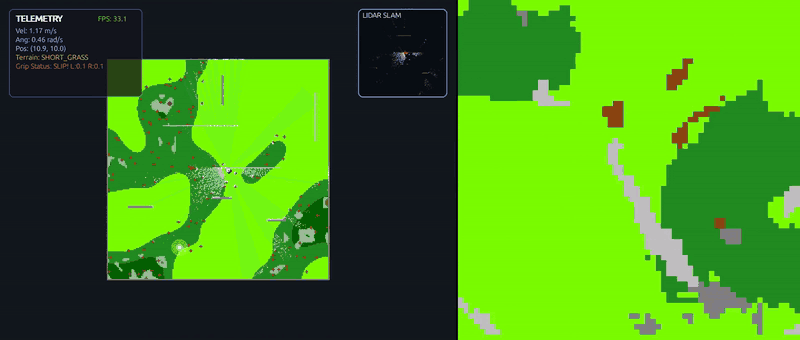
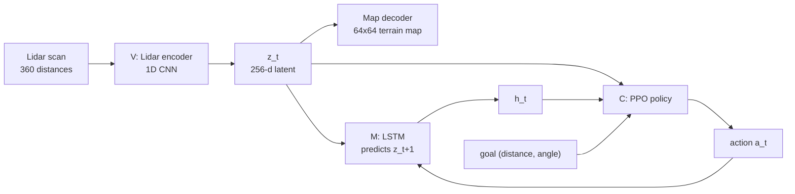
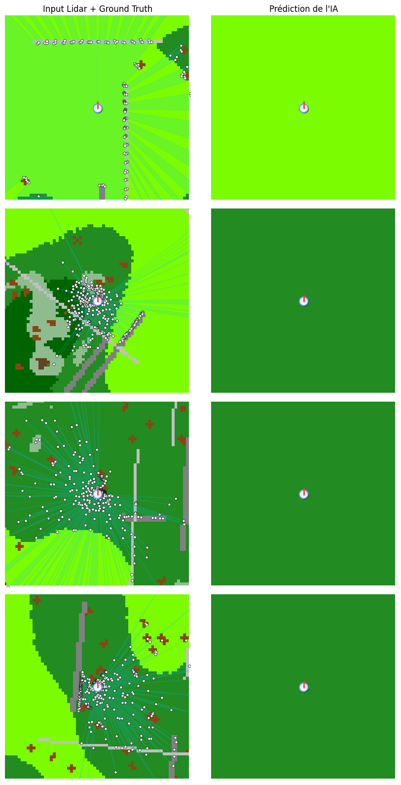

# World Model Navigation

A small differential-drive robot in a 2D procedurally generated terrain. It only sees the world through a 360-ray lidar. The goal is to learn a world model from the lidar (in the spirit of Ha & Schmidhuber's "World Models") and train a navigation policy on top of it.



Left: the simulator (robot, lidar rays, goal in yellow). Right: the local map the model reconstructs from the lidar alone, in the robot's frame.

## How it works



| Part | File | What it does |
|---|---|---|
| V (vision) | `models/world_model.py` | Auto-encoder: lidar scan -> latent `z` -> 64x64 egocentric terrain map. Trained with cross-entropy against the simulator's ground-truth map. |
| M (memory) | `models/mdn_rnn.py` | LSTM that takes `z_t` and the action and predicts `z_t+1`. |
| C (controller) | `scripts/train_controller.py` | PPO (stable-baselines3) that sees `[z_t, h_t, goal]` instead of the raw lidar. |

## Simulator

- Map: 200x200 cells at 10 cm, random terrain each episode (`core/map.py`).
- 9 terrain types (short/medium/tall grass, bushes, trees, walls, fences). Each has its own lidar transparency, friction and wheel grip (`core/terrain.py`). Tall grass lets some rays through, walls block everything.
- Robot: two wheels, action = left/right torque in [-1, 1] (`core/robot.py`).
- Reward: progress towards the goal, small step penalty, bonus on reaching the goal, penalty on collision (`env/sim_env.py`).

## Early result

`predictions.png` comes from an early version of the auto-encoder: it only predicted the dominant terrain class. The demo above uses the later model.



## Running

Dependencies: `torch numpy gymnasium pygame matplotlib tqdm stable-baselines3 opencv-python`

```bash
# drive the robot yourself (arrow keys, R to reset)
python main_teleop.py

# 1. train the vision model
python scripts/collect_data.py --samples 2000
python scripts/train.py --epochs 20

# 2. train the memory model
python scripts/collect_sequences.py --episodes 1000
python scripts/train_rnn.py --epochs 20

# 3. train the controller and record a video
python scripts/train_controller.py --timesteps 300000
python scripts/play_agent.py --output videos/agent_demo.mp4
```

`WorldModel_Training.ipynb` runs the same steps on Colab. `World_Model_Documentation.pdf` (French) describes the auto-encoder architecture.

## Layout

```
core/      map, terrain, robot, lidar
env/       gymnasium environment
render/    pygame viewer
models/    world model (V) and LSTM (M)
scripts/   data collection, training, visualisation
datasets/  a few sample episodes
videos/    agent_demo.mp4
```
